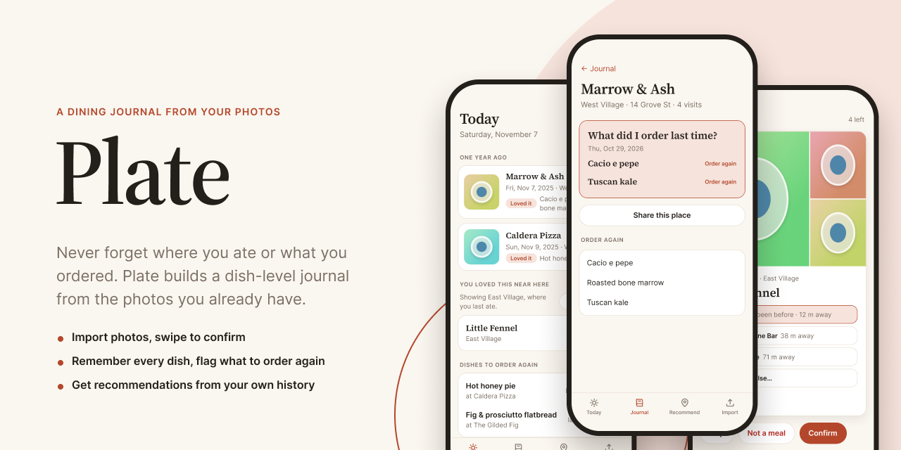
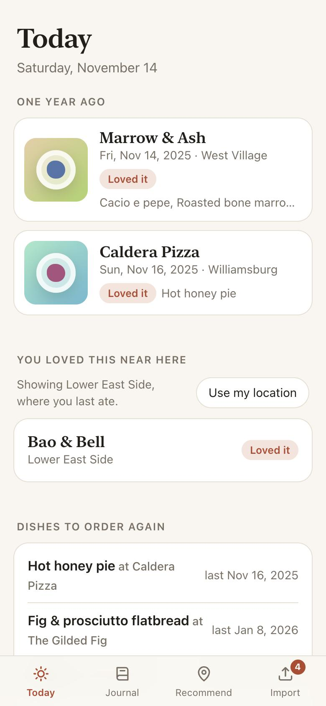
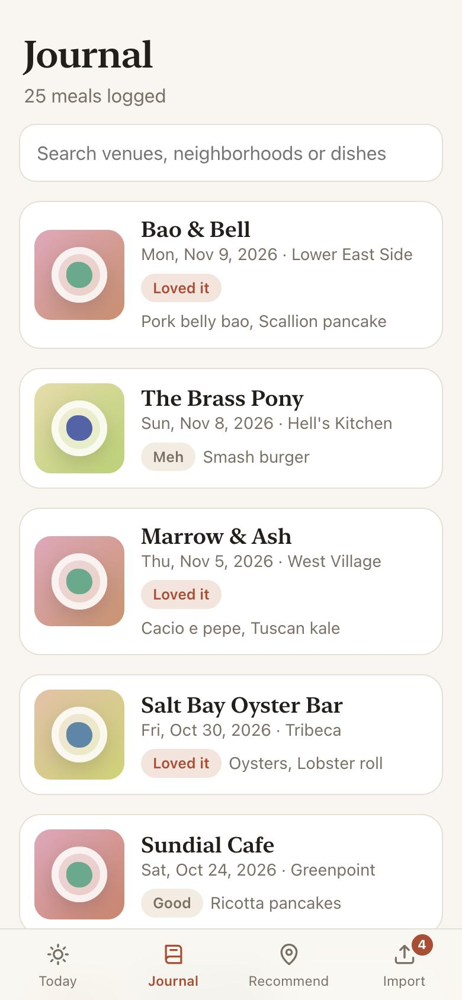
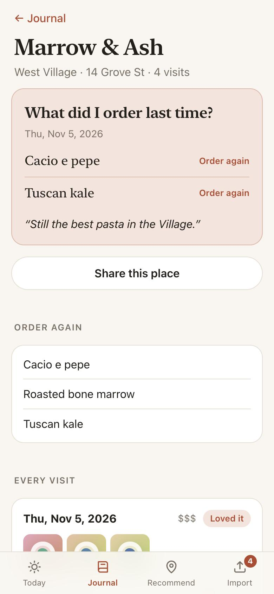
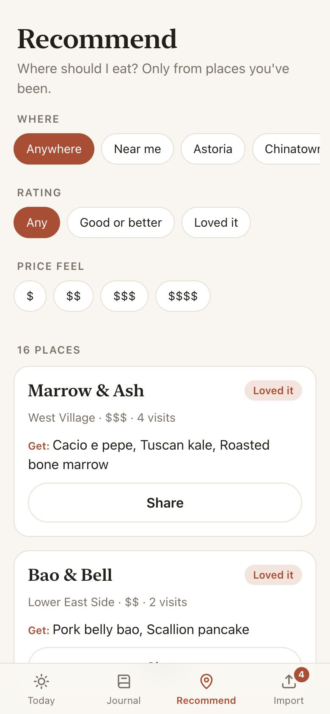
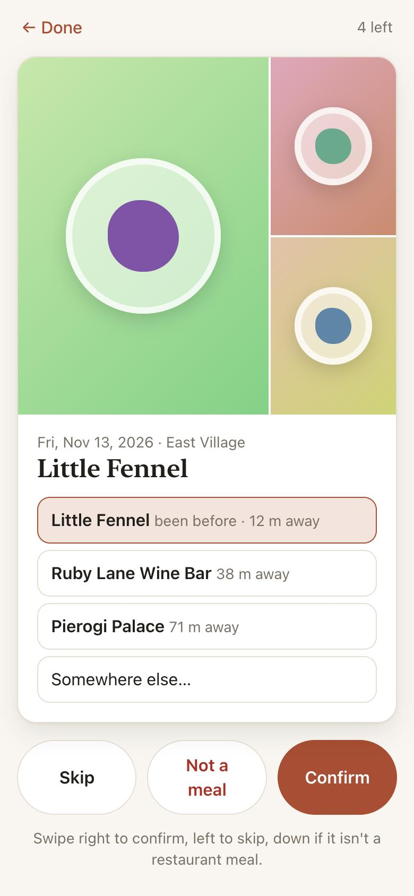

<p align="center">
  
</p>

# Plate

A dish-level dining journal built retroactively from your photos. Pick photos from the last
12 months and Plate finds the food shots, groups them into meals, proposes the restaurant when a
photo has a location, and lets you confirm each one with a swipe. Later it resurfaces what you
loved and answers "where should I eat near X?" using only your own log.

This is a React + Vite + TypeScript app that works fully on-device by default. When Supabase
is configured (see [Supabase setup](#supabase-setup)), you sign in with email and password and
your meals, venues, dishes and review queue sync to your own private rows. Photos and
thumbnails never leave the device.

## Screenshots

<table>
  <tr>
    <td align="center" width="20%"></td>
    <td align="center" width="20%"></td>
    <td align="center" width="20%"></td>
    <td align="center" width="20%"></td>
    <td align="center" width="20%"></td>
  </tr>
  <tr>
    <td align="center"><b>Today</b><br><sub>One year ago, loved nearby, dishes to order again</sub></td>
    <td align="center"><b>Journal</b><br><sub>Every meal, searchable by venue or dish</sub></td>
    <td align="center"><b>Venue page</b><br><sub>"What did I order last time?"</sub></td>
    <td align="center"><b>Recommend</b><br><sub>Filters, results from your own log, one-tap share</sub></td>
    <td align="center"><b>Triage</b><br><sub>Swipe to confirm, skip, or dismiss</sub></td>
  </tr>
</table>

<sub>Screenshots use the built-in demo mode, which loads fictional restaurants and generated
placeholder photos.</sub>

## Setup

Requires Node 20+.

```bash
npm install
npm run dev        # http://localhost:5173
```

Other scripts:

```bash
npm test           # unit tests (vitest)
npm run typecheck  # tsc --noEmit
npm run build      # typecheck + production build into dist/
npm run preview    # serve the production build
```

### Try it without photos: demo mode

Open the **Import** tab, scroll to **Settings** and switch on **Demo mode**. It loads 25
fictional meals at fictional restaurants across about 16 NYC neighborhoods, plus four cards in
the triage queue so you can try the swipe flow. Turning it off removes only the demo data.
Demo photos are generated placeholder tiles, so nothing real is involved.

### Try it with real photos

Import tab → **Choose photos** (or **Choose a folder** in Chromium). Photos from the last 12
months that look like food are kept, with or without GPS. The first scan downloads a
food-recognition model once (see Privacy).

- **With GPS:** clustered by time and place, and the restaurant is proposed from OpenStreetMap.
- **Without GPS:** a photo taken within 3 hours of a located meal joins that meal; otherwise
  photos are grouped by time alone into a card with no suggestions, and you type the venue name
  (previously used venues autocomplete). A photo with no capture date uses the file's modified
  date, which the import summary flags.

## Features

| Tab | What it does |
| --- | --- |
| **Import** | Pre-import privacy explanation, photo/folder picker, scan progress, triage queue count, settings (demo mode, venue lookup toggle, erase data). |
| **Triage** (from Import) | Card stack. Swipe right to confirm, left to skip, down for "not a restaurant meal". Pick a different candidate or type a name. After confirming, rate it (required), optionally add dishes with "order again" flags, a note, companions and a price feel. Arrow keys and buttons work too. Skip and dismiss can be undone. |
| **Journal** | Reverse-chronological meals, searchable by venue, neighborhood or dish. Venue page opens with the **"What did I order last time?"** card, then every visit and dish. |
| **Recommend** | Filters: Anywhere / Near me / neighborhood, minimum rating, price feel. Results come only from your log. One tap shares text like `Via Carota, West Village. Get: cacio e pepe, the Tuscan kale. Loved it.` through the system share sheet (clipboard fallback). |
| **Today** | "One year ago", "you loved this near here", and "dishes to order again". |

## Architecture

```
src/
  core/      Pure TypeScript, no DOM. Unit-tested.
    cluster.ts          photo -> meal clustering
    venueMatcher.ts     venue proposal + fallback chain (VenueSource interface)
    recommendFilter.ts  per-venue summaries and filters
    resurface.ts        one-year-ago / loved-nearby / order-again
    shareFormatter.ts   share text
    neighborhoods.ts    ~40 NYC neighborhood centroids
    types.ts            data model
  data/
    repo.ts             Repository interface: the only persistence contract
    idbRepo.ts          IndexedDB implementation (idb)
    confirmMeal.ts      triage card -> Venue + Meal + Dishes
    seed.ts             demo data
  import/    EXIF reading, thumbnails, CLIP food classifier (Web Worker),
             Overpass venue source, the import pipeline, import controller
  ui/        Tabs, triage, journal/venue pages, shared components, hash router
```

### Data model

`Venue`, `Meal`, `Dish` as specified, with string UUID ids and plain JSON values. Additions:
`Meal.priceFeel` (needed for the price filter), `isDemo` flags, and persisted
`MealCandidate` records for the triage queue.

### Clustering (`core/cluster.ts`)

Photos with a location are sorted by time. Each photo joins the **nearest open cluster**: one whose newest photo
is within 3 hours, whose running centroid is within 100 m, and whose total span stays within
6 hours. Otherwise it starts a new cluster. Comparing against every open cluster (not just the
latest) keeps interleaved places apart, e.g. restaurant, then the bar next door, then back at
the table. Boundaries are inclusive. All thresholds live in `DEFAULT_CLUSTER_CONFIG`. Photos with no location are then attached to the
located meal nearest in time (within the same gap and span limits), or grouped by time alone
(`clusterPhotos`).

### Venue matching (`core/venueMatcher.ts`)

Ranks OpenStreetMap results by distance (venues you have visited get a small boost) and offers
the top three. **Fallback chain** when the lookup returns nothing, fails, times out or is turned
off: (1) venues already in your log within 150 m, then (2) a single "Unknown place" card that
asks you to type the name.

### Supabase setup

UI and pipeline code only talk to the `Repository` interface (`src/data/repo.ts`).

- `idbRepo.ts`: on-device store (IndexedDB). Used alone when Supabase isn't configured or you
  choose "Use on this device only".
- `hybridRepo.ts`: used when signed in. Real meals, venues, dishes and the review queue go to
  Supabase (`supabaseCloud.ts`); photo thumbnails, scan history, settings and **demo data stay
  on the device**. If the cloud is unreachable, reads fall back to device data and Settings
  shows the error. Data created on the device before signing in can be uploaded from
  Import → Account.
- `rows.ts`: camelCase ↔ snake_case mapping.

To turn it on:

1. Copy `.env.example` to `.env.local` and fill in your project URL and **publishable** key
   (never the service-role key). Restart `npm run dev`; Vite reads env files only at startup.
2. Apply the schema in `supabase/migrations/20261107000000_init_plate.sql` (SQL editor, or
   `supabase db push`). It creates `venues`, `meals`, `dishes` and `meal_candidates`, each with
   a `user_id` and an owner-only row-level-security policy.
3. Also apply `supabase/migrations/20261107010000_allow_unlocated_places.sql`, which lets venues
   and review cards have no coordinates (needed for photos without GPS).
4. In the Supabase dashboard go to Authentication → Sign In / Providers → Email. For a
   frictionless prototype, turn **Confirm email** off (otherwise new accounts must click an
   emailed link before signing in; the app handles both cases).

#### Password recovery

Sign-in screen → **Forgot password?** emails a reset link. Following it opens the app on a
"New password" screen; saving signs the user in. An expired or already-used link shows a
message and sends the user back to the sign-in screen. For this to work:

- **Redirect URLs:** in Authentication → URL Configuration, add every origin you run the app
  on to *Redirect URLs* (e.g. `http://localhost:5173`, and your phone-testing address such as
  `http://<your-computer-LAN-IP>:5173`, plus your production URL). Otherwise Supabase sends the link to
  the *Site URL* instead of this app.
- **Email delivery:** Supabase's built-in email sender is for development: it is heavily
  rate-limited and may only deliver to project team members. Configure your own SMTP provider
  (Authentication → SMTP Settings) before real users rely on it.
- The app uses Supabase's implicit flow, where the recovery token arrives in the URL fragment;
  the PKCE flow needs a secure (HTTPS) context, which plain-HTTP LAN testing doesn't have.

Row-level security is what protects the data: the publishable key is public by design and is
useless without a signed-in user's session.

## Privacy and network use

- Everything is processed in your browser. There are no analytics. Accounts exist only if you
  configure Supabase.
- With Supabase on and a signed-in user, confirmed meals, venues (including their coordinates),
  dishes and the review queue are stored in your Supabase project, protected by row-level
  security. Demo data and photos are never uploaded.
- Original photos are **never stored**. Only a small JPEG thumbnail (480 px) of each kept food
  photo is saved, in IndexedDB on your device. On a second device, synced meals appear without
  their photos.
- Network calls, all disclosed in the app before the first import:
  1. **One-time model download** from the Hugging Face CDN (a CLIP model, roughly 50-90 MB),
     then cached by the browser. Classification runs locally.
  2. **Venue lookup**: each meal's location, rounded to 4 decimals (about 11 m), is sent to the
     public OpenStreetMap Overpass API (`overpass-api.de`, with `overpass.kumi.systems` as a
     backup). No photos or other data are sent. Turn this off in Settings and venue names
     are typed by hand.
- Geolocation (for "Near me") is requested only when you tap it and is kept in memory only.

## Tests

```bash
npm test
```

Covers: clustering time and distance thresholds (including exact boundaries, interleaving and the
span cap); venue-matching fallback when lookup returns nothing, throws, times out or is switched
off; the Overpass parser and client; the import pipeline with injected fakes; triage
confirmation; recommend filters; resurfacing; the share formatter; demo data integrity.

## Known limitations

- **No camera-roll API on the web.** You pick photos or a folder; Plate can't scan in the
  background. iOS Safari may strip GPS from picked photos, so choose Options → Location:
  Include, or import from a desktop folder. HEIC files only decode in Safari.
- **Thumbnails are stored** (not original photos), because a browser can't reference your files
  later. Clear them with Settings → Erase all data.
- **Food detection is approximate.** It uses zero-shot CLIP with a score threshold
  (`IMPORT_CONFIG` in `src/import/importConfig.ts`) that needs tuning on real photos. The triage
  step lets you dismiss mistakes.
- **OpenStreetMap coverage varies**; dense blocks or new restaurants may show the wrong venue or
  none. Use "Somewhere else…" to type it.
- **Haptics** use the Vibration API: Android only. iOS Safari has none, so swipes snap visually.
- **Voice dictation** relies on your keyboard's microphone button, not the Web Speech API
  (Chrome's sends audio to a server).
- Each import run is clustered on its own, so a meal split across two separate imports becomes
  two cards.
- The real import path (EXIF GPS from an actual phone photo, the CLIP model, live Overpass
  results) has been exercised only through unit tests with injected fakes, not end to end on a
  real photo library.
- The service worker is a minimal app-shell cache; it is registered only in production builds.
- Neighborhood names come from Overpass tags or a bundled table of NYC centroids, so labels near
  borders can be off.
